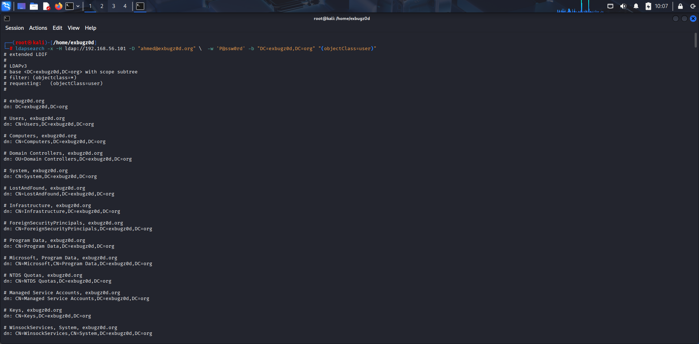
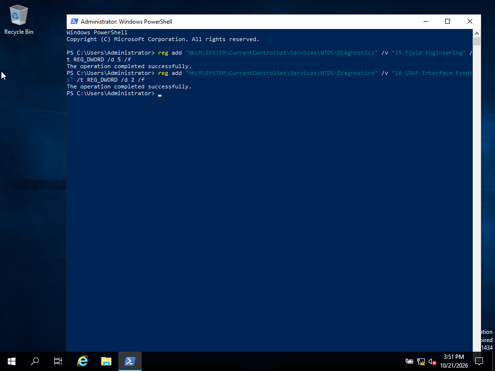
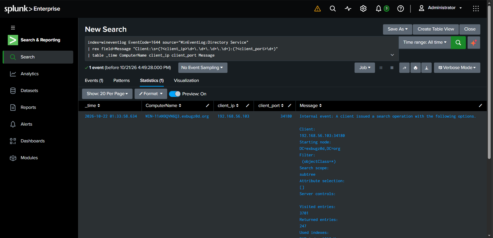
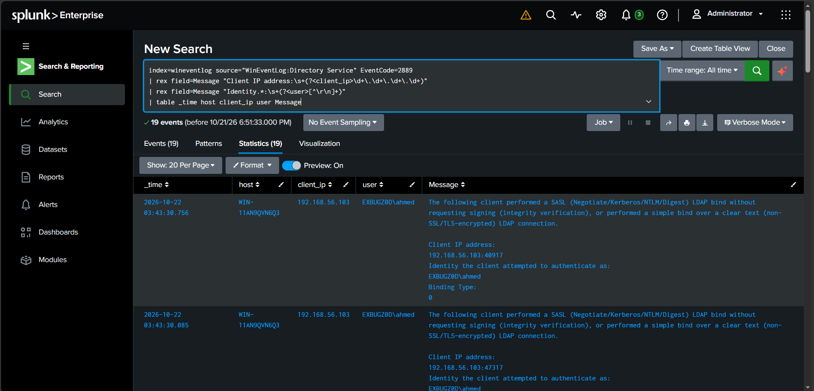
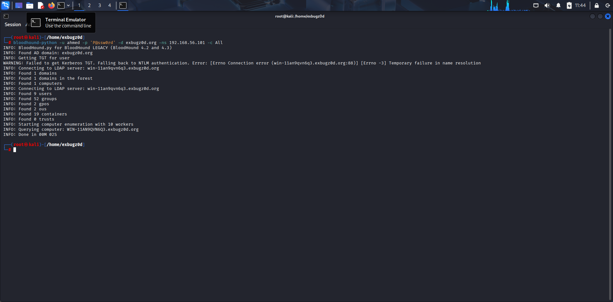
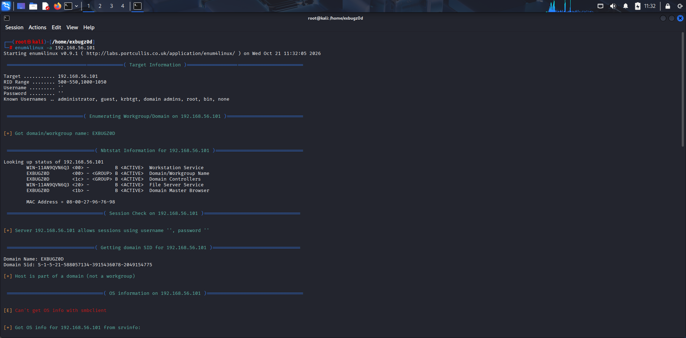
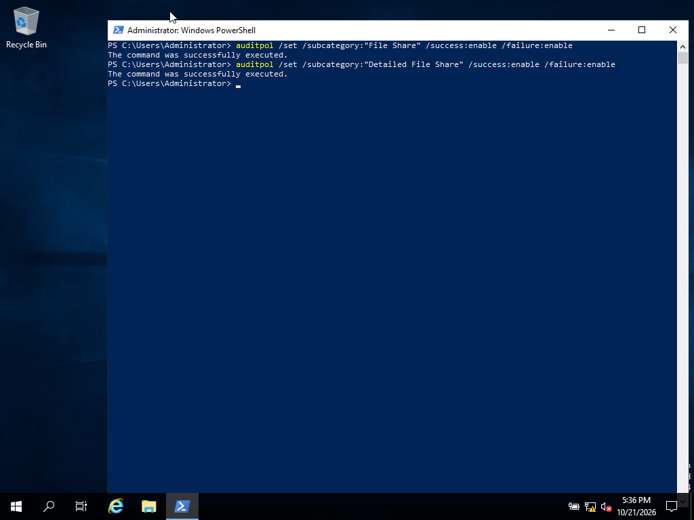
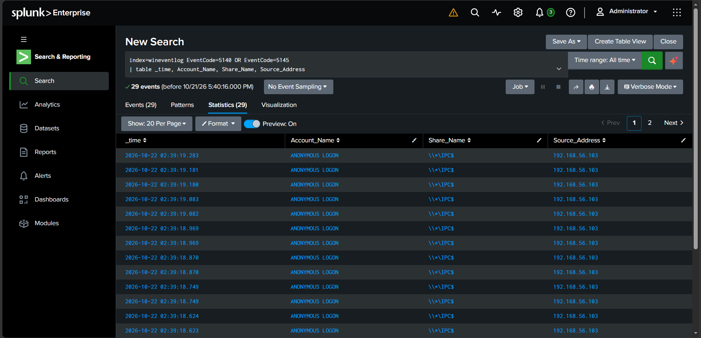

# Phase 2 — Reconnaissance & Enumeration

Part of the [Splunk SOC Home Lab](../) series. This phase covers unauthenticated and low-privilege
enumeration of an Active Directory environment, and how to make each technique visible in Splunk
even though most of it is **not logged by Windows out of the box**.

## Environment

| Role | Host |
|---|---|
| Domain Controller | `WIN-11AN9QVN6Q3` (Windows Server, AD DS) |
| Attacker | Kali Linux |
| SIEM | Splunk Enterprise + Universal Forwarder on the DC |

## Techniques covered

| Technique | MITRE ATT&CK |
|---|---|
| LDAP Enumeration | [T1087.002](https://attack.mitre.org/techniques/T1087/002/), [T1482](https://attack.mitre.org/techniques/T1482/) |
| BloodHound Collection | [T1087.002](https://attack.mitre.org/techniques/T1087/002/), [T1482](https://attack.mitre.org/techniques/T1482/) |
| SMB / Null Session Enumeration | [T1135](https://attack.mitre.org/techniques/T1135/), [T1046](https://attack.mitre.org/techniques/T1046/) |

---

## 1. LDAP Enumeration

### Attack
```bash
ldapsearch -x -H ldap://<dc-ip> -D "ahmed@<domain>" -w '<password>' \
  -b "DC=<domain-component>,DC=<tld>" "(objectClass=user)"
```
This dumps the full LDAP tree — OUs, Domain Controllers, user objects, trust containers — with no
special privileges beyond a valid domain credential.



### Why this matters
Windows does **not** log LDAP search filters by default. An attacker can run broad queries like
`(objectClass=*)` against the entire directory and leave essentially no trace unless Directory
Service diagnostics are explicitly enabled.

### Detection setup (not on by default)
```powershell
reg add "HKLM\SYSTEM\CurrentControlSet\Services\NTDS\Diagnostics" /v "15 Field Engineering" /t REG_DWORD /d 5 /f
reg add "HKLM\SYSTEM\CurrentControlSet\Services\NTDS\Diagnostics" /v "16 LDAP Interface Events" /t REG_DWORD /d 2 /f
```
```ini
# Universal Forwarder inputs.conf
[WinEventLog://Directory Service]
disabled = 0
```



### Detecting it — Event ID 1644 (search filter + client IP)
```spl
index=wineventlog source="Directory Service" EventCode=1644
| table _time, Client_IP, Filter, Duration, Entries_Returned
```


### Bonus detection — Event ID 2889 (unsigned / cleartext bind)
Catches the client's identity even when the search filter itself looks benign — `ldapsearch` and
`bloodhound-python` frequently don't negotiate LDAP signing, which trips this event.
```spl
index=wineventlog source="WinEventLog:Directory Service" EventCode=2889
| rex field=Message "Client IP address:\s+(?<client_ip>\d+\.\d+\.\d+\.\d+)"
| rex field=Message "Identity.*:\s+(?<user>[^\r\n]+)"
| table _time, host, client_ip, user, Message
```


### False positives
Legitimate admin tools (ADUC, the PowerShell AD module) generate similar LDAP queries. Baseline
known admin workstations and alert on unusual source hosts or unusually broad/bulk queries rather
than on the presence of LDAP traffic alone.

---

## 2. BloodHound Collection

### Attack
```bash
bloodhound-python -u ahmed -p '<password>' -d <domain> -ns <dc-ip> -c All
```
Collects users, groups, GPOs, OUs, containers, and trust relationships for offline attack-path
analysis in the BloodHound GUI.



### Troubleshooting note
Hit this warning during collection:
```
WARNING: Failed to get Kerberos TGT. Falling back to NTLM authentication.
Error: [Errno Connection error ... ] [Errno -3] Temporary failure in name resolution
```
Collection still completed successfully, but this points to the attacker box's DNS resolver not
being pointed at the DC (`/etc/resolv.conf`). Kerberos needs working forward/reverse DNS to the DC;
without it, tools silently fall back to NTLM. Worth fixing before later phases that rely on
Kerberos (Kerberoasting, AS-REP roasting) to avoid confusing failures.

### Detection
Same 1644 / 2889 searches above catch BloodHound's LDAP traffic — it is, under the hood, just a
very large volume of LDAP queries from one source in a short window.

---

## 3. SMB / Null Session Enumeration

### Attack
```bash
enum4linux -a <dc-ip>
crackmapexec smb <dc-ip> --shares
smbclient -L //<dc-ip>/ -N
```
Confirms null sessions are allowed, pulls the domain name and SID, NetBIOS service info, and
enumerates shares.



### Why this matters
`4624` (Logon Type 3) logs by default, but `5140` (share accessed) and `5145` (detailed share
access check) — the events that actually show **which share** was touched — do not, until the
"Audit File Share" / "Audit Detailed File Share" subcategories are turned on.

### Detection setup (not on by default)
```powershell
auditpol /set /subcategory:"File Share" /success:enable /failure:enable
auditpol /set /subcategory:"Detailed File Share" /success:enable /failure:enable
```


These land in the regular Security log — no extra `inputs.conf` stanza needed if Security is
already forwarded.

### Detecting it
```spl
index=wineventlog EventCode=5140 OR EventCode=5145
| table _time, Account_Name, Share_Name, Source_Address
```


In the lab run, this surfaced 29 events of `ANONYMOUS LOGON` repeatedly accessing `\\*\IPC$` from
the attacker's IP — a clean signature of null-session enumeration tooling.

### Note on SAMR enumeration
Some `enum4linux`/CrackMapExec modules pull user/group lists over RPC (SAMR) rather than SMB share
access. This has **no dedicated Windows event at all** by default — visibility here is limited to
Sysmon Event ID 3 tying a process to port 445/135, or blocking it outright via "Network access:
Restrict clients allowed to make remote calls to SAM" (which blocks silently, it doesn't log).

### False positives
Null sessions are rare in hardened environments, so frequent anonymous logons across many hosts
are a strong indicator — but confirm asset inventory first, since some legacy printers/scanners
still rely on them.

---

## Verifying the detection pipeline itself

Before trusting any of the searches above, confirm the logging changes actually took effect rather
than assuming the command worked:
```powershell
reg query "HKLM\SYSTEM\CurrentControlSet\Services\NTDS\Diagnostics" /v "15 Field Engineering"
auditpol /get /subcategory:"File Share"
auditpol /get /subcategory:"Detailed File Share"
type "C:\Program Files\SplunkUniversalForwarder\etc\system\local\inputs.conf"
```
This closes the loop end-to-end: audit policy enabled on the DC → forwarder configured to collect
it → event actually shows up in Splunk.

---

## Lessons learned
- LDAP and SMB share-access auditing are both **off by default** on a fresh DC — don't assume
  "Security log forwarded" means full visibility.
- Kerberos-dependent tools need working DNS to the DC, or they silently degrade to NTLM.
- Pairing an attacker-side screenshot with the matching Splunk event (same source IP / account /
  timeframe) is far more convincing in a writeup than either one alone.
